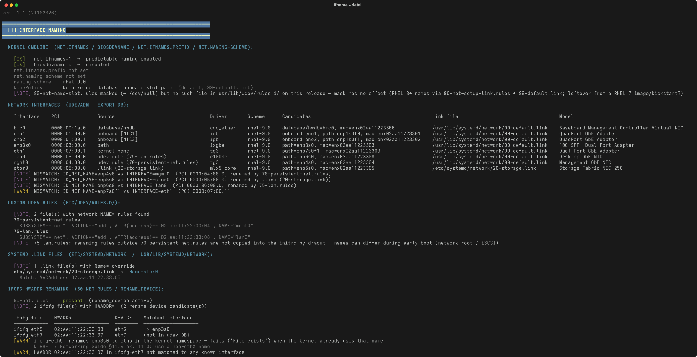

# ifname

Analyzes how network interfaces are renamed by reading a udev database, in the format produced by a sosreport. Not RHEL-specific: it just parses `udevadm info --export-db` output, so it works on any systemd-based Linux distribution (also tested on Fedora). Style and output aligned with its companion tool `sos-net` (`--ifname`/`--ifname-d`).

## In action

`ifname --detail` against a sample system (onboard NICs, a hwdb-named management interface, renames via custom udev rules and a `.link` file, a leftover RHEL 7 naming mask that has no effect, a failed rename that kept a kernel `ethX` name, and legacy ifcfg/HWADDR renames — sample data, not a real system):



## Requirements

- Python 3.9+
- A sosreport (or a plain `udevadm info --export-db` dump) collected on a systemd-based Linux system — RHEL, Fedora, and other distributions

## Installation

```bash
bash install.sh
```

The script is copied to `~/bin/ifname` and made executable. If `~/bin` is not in your `PATH`, the installer prints the line to add to `~/.bashrc`.

After installation, three equivalent modes:

```bash
# 1. from the sosreport root directory (original usage)
cd sosreport-xxx/
ifname
ifname --detail   # or -d

# 2. passing the root directory as an argument (like sos-net)
ifname sosreport-xxx/
ifname sosreport-xxx/ -d

# 3. passing the udev DB file path directly
ifname sosreport-xxx/sos_commands/devices/udevadm_info_--export-db -d
```

## Running without installing

```bash
python3 ifname.py                    # from the sosreport root
python3 ifname.py sosreport-xxx/     # or by passing the path
python3 ifname.py --detail           # or -d, either way
```

## Version

```bash
ifname -v
# ifname version 1.1 (21102026) by manumaiden
```

On every normal run (not `-v`), the version is printed as the first line of output.

## Colors

Output uses the same ANSI colors as `sos-net`: green `[OK]`, yellow `[WARN]`, magenta `[NOTE]`, blue `[INFO]`, cyan/bold headers. Colors auto-disable when output isn't a terminal (pipe, file redirect) and can be turned off explicitly with `--no-color`:

```bash
ifname --no-color sosreport-xxx/
```

## What it analyzes

Output is organized into a single section (`INTERFACE NAMING`) with five subsections:

1. **Kernel cmdline** — `net.ifnames`, `biosdevname`, `net.ifnames.prefix`, `net.naming-scheme` read from `proc/cmdline`; the naming scheme udev actually used (`ID_NET_NAMING_SCHEME`, `[WARN]` if it differs from `net.naming-scheme=`); the effective `NamePolicy` (`[NOTE]` for `/etc` `.link` files overriding it); naming rules **masked** with a link to `/dev/null` — `[WARN]` when the mask really disables consistent naming, `[NOTE]` when it has no effect (e.g. the RHEL 7 `80-net-name-slot.rules` mask left on RHEL 8+, where that rule no longer exists) or when its effect can't be verified; `[NOTE]` if the biosdevname package is installed on a non-Dell system
2. **Interface table** — for every PCI NIC: name, PCI address, **what actually produced the name** (`Source`), driver, scheme, model; `--detail` also shows every naming candidate and the applied `.link` file; mismatches between `ID_NET_NAME` and `INTERFACE` are a `[NOTE]` when explained (udev rule, `.link`, ifcfg, biosdevname, prefixdevname) and a `[WARN]` otherwise
3. **Custom udev rules** — rules in `etc/udev/rules.d/` that assign `NAME=` to network interfaces, with a `[NOTE]` for files other than `70-persistent-net.rules` (the only one dracut copies into the initrd)
4. **.link files with Name=** — explicit overrides in `etc/systemd/network/` and `usr/lib/systemd/network/`
5. **ifcfg HWADDR renaming** — the legacy `rename_device`/`60-net.rules` mechanism based on `HWADDR=`/`DEVICE=` in `ifcfg-*` files: `[WARN]` for `DEVICE=` without `60-net.rules` (the rename never happens) and for renames into the kernel `ethX` namespace (they fail with "File exists")

## Naming logic

The logic follows the rename procedure documented by Red Hat — RHEL 7 *Networking Guide*, chapter 11, and RHEL 8/9/10 *Configuring and managing networking*, chapter 1:

| Step | RHEL 7 | RHEL 8 / 9 / 10 |
|---|---|---|
| 1 | `60-net.rules` — `rename_device`: `ifcfg-*` with `HWADDR=` → name from `DEVICE=` | same, optional (`initscripts-rename-device` package on RHEL 9+; skipped on keyfile-only systems) |
| 2 | `71-biosdevname.rules` (if biosdevname is installed and enabled) | same, Dell systems only |
| 3 | `75-net-description.rules` — computes the `ID_NET_NAME_*` candidates | same |
| 4 | `80-net-name-slot.rules` — onboard → slot → path | `80-net-setup-link.rules` — `NamePolicy` from `99-default.link` |

Default `NamePolicy`: RHEL 8 `kernel database onboard slot path`, RHEL 9/10 `keep kernel database onboard slot path`. The `mac` policy (`enx*`) is never used by default. On RHEL 7, kernel `ethX` names only work reliably with a single NIC or with virtio NICs in RHEL 7 guests: in those cases disabled naming is a `[NOTE]`, not a `[WARN]`.

The `Source` column does not take the first available candidate (`75-net-description.rules` always computes them, even when they are not used): it looks for what matches the real name, in this order — prefixdevname → candidate equal to the name (database/hwdb, onboard, slot, path, mac) → custom udev rule → `.link` file → ifcfg `DEVICE=` → biosdevname → kernel name `ethN`.

## Files read from the sosreport

| File | Required | Content used |
|------|:---:|-----------------|
| `sos_commands/devices/udevadm_info_--export-db` | Yes | udev properties for every interface |
| `proc/cmdline` | No | `net.ifnames`, `biosdevname`, `net.ifnames.prefix`, `net.naming-scheme` parameters |
| `etc/redhat-release` | No | Major release (default NamePolicy, RHEL 7 cases) |
| `sos_commands/hardware/dmidecode` | No | Manufacturer (biosdevname is for Dell only) |
| `etc/udev/rules.d/*.rules` | No | Custom renaming rules and masked rules (links to `/dev/null`) |
| `usr/lib/udev/rules.d/80-net-*.rules`, `71-biosdevname.rules` | No | Actual effect of masks, biosdevname presence |
| `etc/systemd/network/*.link`, `usr/lib/systemd/network/*.link` | No | `.link` files with `Name=` or `NamePolicy=`, masked `.link` files |
| `usr/lib/udev/rules.d/71-prefixdevname.rules` | No | Checks whether the prefixdevname package is present (only if `net.ifnames.prefix` is set) |
| `etc/sysconfig/network-scripts/ifcfg-*` | No | `HWADDR=`/`DEVICE=` for legacy `rename_device` renaming |
| `usr/lib/udev/rules.d/60-net.rules`, `etc/udev/rules.d/60-net.rules` | No | Presence of the `rename_device` mechanism |

## License

MIT — see [LICENSE](LICENSE).
